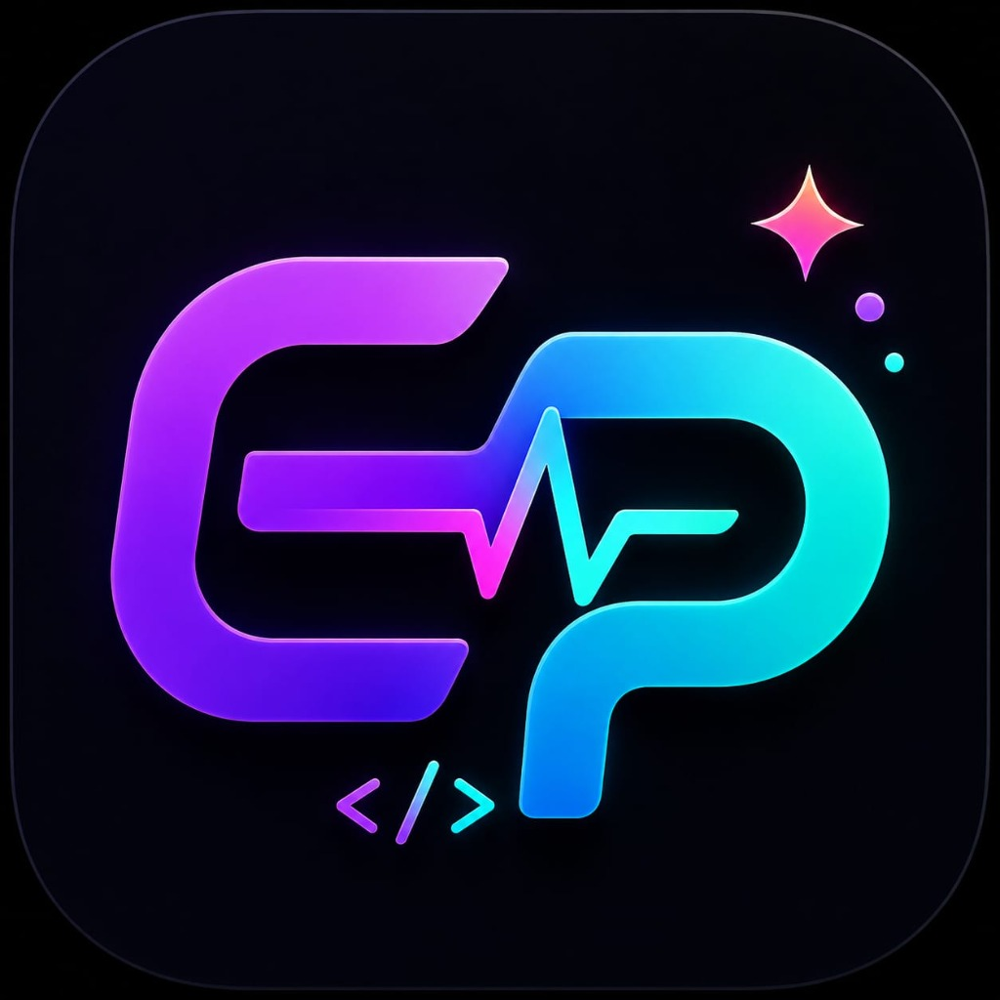
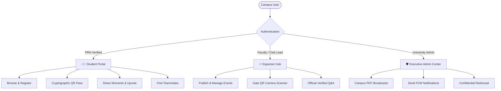

<div align="center">

  

  # ⚡ EventPulse
  ### Next-Generation University Event & Campus Life Super-Platform

  <p align="center">
    <strong>Empowering modern university campuses with Cryptographic QR Entry Passes, AI Campus Copilot, Teammate Squad Matchmaking, Shared Moments Gallery, and Multi-Page HD Notice Broadcasts.</strong>
  </p>

  [](https://eventpulse-su-34a42.web.app)
  [](https://vitejs.dev/)
  [](https://firebase.google.com/)
  [](https://developer.mozilla.org/)
  [](LICENSE)

</div>

---

## 🌟 Overview

**EventPulse** is a university-scale event management and student engagement ecosystem engineered from the ground up for modern campuses. Built with zero-dependency high-performance Vanilla ES6+, reactive Firestore real-time listeners, and Vite bundling, EventPulse streamlines every touchpoint of campus life — from event discovery and squad-building to anti-fraud entry passes and verified certificate generation.

🌐 **Production Deployment**: [https://eventpulse-su-34a42.web.app](https://eventpulse-su-34a42.web.app)

---

## 🔑 Demo & Test Accounts

You can explore all platform views using the pre-seeded demo accounts or register a new student account using your campus PRN:

| Role | Email | Password | PRN / ID | Scope of Access |
|---|---|---|---|---|
| **👨‍🎓 Student** | `student@univ.edu` | `password123` | `2024CS001` | Browse events, claim passes, squad finder, Q&A, certificates, wishlists |
| **👩‍🎓 Student (Alt)** | `ananya@univ.edu` | `password123` | `2024IT042` | Student portal, RSVP, campus moments feed |
| **⚡ Organizer** | `organizer@univ.edu` | `password123` | `FAC-802` | Event creation, live QR camera gate scanner, verified badges in Q&A |
| **🛡️ Administrator** | `admin@univ.edu` | `password123` | `ADM-001` | Campus broadcasts with PDF notices, PRN registry, grievances, push notifications |

> **Quick Sign-Up**: Students can also sign up immediately with any email and unique PRN via the **Student Registration** portal tab.

---

## 🚀 Key Features

### 🎫 1. Anti-Fraud Cryptographic Digital Passes
- **Tamper-Proof Single-Use Tokens**: Every pass is cryptographically signed and tied directly to the student's authenticated PRN.
- **Organizer Turbo Scanner**: High-speed camera scanner using HTML5 camera streams with instant audio & haptic feedback (`Beep` for valid admission, `Buzz` for duplicates/invalid passes).
- **Offline Pass Resilience**: Event passes are cached client-side to ensure 0ms rendering even in underground auditoriums or spotty campus Wi-Fi.

### 🤖 2. NEX AI — 24/7 Intelligent Campus Copilot
- Context-aware campus assistant powered by client-side intelligence.
- Instantly answers queries about upcoming hackathons, eligibility criteria, PRN issues, venue locations, and campus support desks.
- Generates event descriptions and rulebooks for campus organizers on demand.

### 📸 3. Campus Moments Wall
- **Live Memory Feed**: Students and attendees share high-resolution photos during cultural fests, sports tournaments, and tech hackathons.
- **Lightbox Photo Viewer**: Full-screen immersive photo viewer with gesture support and live ❤️ upvotes.
- **Client-Side Compression**: Automatically balances bandwidth and visual clarity by scaling uploads up to 1200px before cloud upload.

### 📅 4. 1-Click Google & Apple Calendar Sync
- **Universal Calendar Integration**: Pre-fills date, time window, venue location, description, and pass deep-link.
- **Apple & Outlook (.ics)**: Instant dynamic standard iCalendar download with an automated 1-hour pre-event reminder alarm.

### 💬 5. Event Discussion & Live Q&A
- **Direct Communication**: Attendees can ask questions regarding kit requirements, reporting deadlines, and guidelines.
- **Verified Staff Answers**: Responses from organizers and faculty are badged with official verification tags.
- **Community Upvotes**: Students upvote queries to surface the most critical FAQs.

### 🤝 6. Teammate & Squad Finder
- Eliminates the friction of finding hackathon and competition partners.
- Filter candidates by domain skills: Frontend, Backend, AI/ML, UI/UX, or Hardware.
- 1-click squad requests and WhatsApp collaboration links.

### 📢 7. High-DPI Campus Broadcasts & PDF Engine
- Critical campus-wide notices, exam alerts, and fest schedules.
- **Multi-Page Canvas Engine**: PDF.js super-sampled at 2.5x High-DPI resolution for crisp document viewing on any mobile or desktop screen.
- **XSS-Sanitized Linkification**: Auto-detects and activates secure links to registration forms and rulebooks.

---

## 🏗️ Architecture & Project Structure

EventPulse is structured as a modern, modular single-page application built on Vite:

```
EventPulse/
├── src/
│   ├── assets/          # Static branding and graphics
│   ├── components/      # UI components: Modals, Pass Card, Scanner, AI Widget, Lightbox
│   ├── services/        # Firebase Auth, Firestore, FCM Push, QR Engine, PDF.js renderer
│   ├── styles/          # Responsive Glassmorphic Design System & Themes
│   ├── views/           # Modular SPA Views (Events, Passes, Admin, Organizer, Moments)
│   ├── firebase.js      # Production Firebase Cloud SDK Setup (with .env support)
│   └── main.js          # App Bootstrap & Client-Side Hash Router
├── functions/           # Firebase Admin SDK & Push Notification Cloud Functions
├── public/              # Service Workers, PWA Manifest, HD Posters & Logos
├── scripts/             # Database Seeding & User Sync Utilities
├── .env.example         # Template for environment configuration
├── firestore.rules      # Production Firestore Security Rules
└── vite.config.js       # Vite build optimization & chunking configuration
```

### Technology Matrix

| Layer | Technology |
|---|---|
| **Frontend Framework** | Vanilla ES6+ JavaScript, HTML5 Canvas, Modern CSS3 |
| **Bundler & Build Tool** | Vite 6.x with Code Splitting & Tree Shaking |
| **Backend & Database** | Google Cloud Firestore (Real-time NoSQL) |
| **Authentication** | Firebase Authentication (Email/Password & Google OAuth) |
| **Push Notifications** | Firebase Cloud Messaging (FCM) & Background Service Worker |
| **Document Rendering** | PDF.js with Super-Sampled HTML5 Canvas Renderer |
| **Pass Generation** | Client-Side QR Code Engine (`qrcode` + `html5-qrcode`) |
| **Hosting & CDN** | Firebase Global Edge Hosting (SSL / HTTP/2) |

---

## ⚡ Quick Start & Setup Guide

### Prerequisites
- [Node.js](https://nodejs.org/) (v18.0.0 or higher recommended)
- `npm` or `yarn`

### 1. Clone the Repository
```bash
git clone https://github.com/thoratpratik2323-hue/Event-Pulse.git
cd Event-Pulse
```

### 2. Configure Environment Variables
Copy the example environment file and customize it if using your own Firebase project:
```bash
cp .env.example .env
```
*(If omitted, EventPulse will run with default production Firebase configuration).*

### 3. Install Dependencies
```bash
npm install
```

### 4. Start Local Development Server
```bash
npm run dev
```
Open [http://localhost:5173](http://localhost:5173) in your browser.

### 5. Build for Production
```bash
npm run build
```
Production assets are bundled and optimized inside the `dist/` directory.

### 6. (Optional) Deploy to Firebase Hosting
```bash
npm install -g firebase-tools
firebase login
firebase deploy --only hosting
```

---

## 👥 Role-Based Governance Model



---

## 📄 License

This project is open-source and distributed under the [MIT License](LICENSE).

---

## 👨‍💻 Author & Acknowledgements

**Pratik Thorat**
- GitHub: [@thoratpratik2323-hue](https://github.com/thoratpratik2323-hue)
- Repository: [Event-Pulse](https://github.com/thoratpratik2323-hue/Event-Pulse)

<div align="center">
  <sub>Built with ❤️ for University Campuses across India 🇮🇳</sub>
</div>
